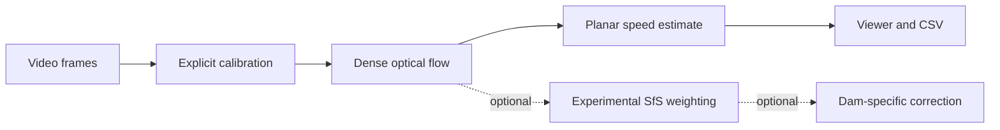

# Fluid Dynamics Video Analysis

A research-oriented desktop application for estimating **image-plane motion**
from video with dense optical flow. It originated in the University of
Queensland DECO3801 studio project on dam-spillway footage and now separates a
tested optical-flow baseline from dataset-specific experiments.

This repository is not a certified flow meter. The public test data validates
known 2D image translations, not turbulent-water physics, physical depth, or
field accuracy.

## Engineering focus

- Dense Farneback optical flow behind a validated, reusable numerical API.
- Explicit spatial calibration; the application no longer silently substitutes
  a hard-coded metres-per-pixel value after failed calibration.
- Deterministic synthetic benchmarks with known displacement and controlled
  noise.
- A real encoded-video demo that calculates endpoint and speed error against
  ground truth.
- Interactive ROI selection, velocity visualisation, CSV export, profiles and
  time-series inspection.
- Experimental Shape-from-Shading and dam-specific perspective corrections
  remain available only through explicit command-line flags.



## Reproducible validation

Create a virtual environment and install the application dependencies:

```bash
python3 -m venv .venv
source .venv/bin/activate
python -m pip install -r requirements.txt
python -m pip install -r requirements-ci.txt
```

Run the checks:

```bash
python -m pytest -q
python benchmark_optical_flow.py --check
MPLBACKEND=Agg python demo.py
```

On 16 November 2026, the checked environment used OpenCV 5.0.0 and produced:

| Check | Observed result |
|---|---:|
| Unit and numerical tests | 7 passed |
| Subpixel translation p95 endpoint error | 0.030 px |
| 8 px translation p95 endpoint error | 0.038 px |
| Noisy translation p95 endpoint error | 0.387 px |
| Encoded-video demo p95 endpoint error | 0.417 px |
| Encoded-video demo median speed error | 4.50% |

The benchmark thresholds are encoded in source and enforced by CI. Results can
vary with OpenCV versions, CPU implementations and video codecs, which is why
the workflow reruns the measurements rather than relying on this table alone.

The demo writes:

- `demo_input.mp4`
- `demo_velocity_heatmap.png`
- `demo_velocity_profile.png`
- `demo_metrics.json`

These generated files are ignored by Git.

## Run the interactive application

Install the full dependencies, then supply a video:

```bash
python main.py --video /path/to/video.mp4 --rotation 0
```

The application asks the user to mark a known distance. If calibration is
cancelled, it stops without reporting a physical velocity. For a previously
measured calibration:

```bash
python main.py \
  --video /path/to/video.mp4 \
  --rotation 0 \
  --metres-per-pixel 0.0025
```

The value above is only an example; it must be measured for the actual camera
and scene. The recording frame rate must also be valid. The app reads FPS from
video metadata and **stops if metadata is zero, missing, or non-finite** rather
than silently pretending the recording was 25 FPS. When metadata is known to
be incorrect, provide a verified recording FPS explicitly:

```bash
python main.py --video /path/to/video.mp4 --rotation 0 \
  --metres-per-pixel 0.0025 --fps 29.97
```

Do not guess FPS: an incorrect rate directly scales the reported velocity.

The exported CSV uses the full-frame image row as its depth origin:
`depth = image_row × metres_per_pixel`. One-metre bins include partial bins,
omit ROIs with no processed frames, and combine overlapping ROIs by weighting
every observed pixel equally. This makes the export reproducible, but it does
not turn image-plane depth into a surveyed world coordinate.

Two original research experiments are opt-in:

```bash
python main.py \
  --video /path/to/video.mp4 \
  --experimental-sfs-refinement \
  --dam-perspective-correction
```

The perspective table is specific to the original dam geometry. The SfS
weighting assumes a Lambertian surface, fixed illumination and tuned
regularisation. Neither option is covered by the public ground-truth benchmark,
so neither is enabled by default.

## Repository structure

| Path | Purpose |
|---|---|
| `flow_analysis.py` | Validated optical-flow and velocity primitives |
| `benchmark_optical_flow.py` | Deterministic translation/noise benchmark |
| `demo.py` | Encoded-video ground-truth demonstration |
| `main.py` | Interactive analysis and PyQt results viewer |
| `preprocessing.py` | Rotation, contrast, gamma and calibration tools |
| `velocity_aggregation.py` | Geometry-aware depth-bin and vertical-profile aggregation |
| `SFSImplementation.py` | Experimental standalone Shape-from-Shading pipeline |
| `tests/` | Numerical and preprocessing tests |
| `docs/adr/` | Architecture decisions and evidence boundaries |

## Research data and limitations

The original spillway footage is not distributed because access is controlled
by the University project stakeholders. The public synthetic inputs are
deterministic and reproducible but do not reproduce turbulence, reflections,
occlusion, camera vibration or depth-dependent perspective.

Other limitations:

- Optical flow depends on visible texture and brightness consistency.
- Metres-per-second output is only as accurate as the frame rate and spatial
  calibration supplied by the user.
- No uncertainty interval is yet propagated from calibration to velocity.
- An explicit FPS override is trusted when supplied; the software cannot
  independently prove that the camera recorded at the claimed rate.
- No public real-water dataset or independent sensor measurement is included.
- Shape-from-Shading outputs are relative research estimates, not validated
  physical depth.
- CI renders the populated Qt/Matplotlib results plot offscreen and checks its
  labels at the default panel size. ROI selection, hover/click interaction and
  the original dataset workflow still require visual/manual review.

## Project history

Developed at the University of Queensland for DECO3801 / Studio 3 in 2025 and
subsequently refactored for reproducible portfolio evidence. See
[CHANGELOG.md](CHANGELOG.md) and
[ADR 0001](docs/adr/0001-validated-baseline.md).

## Licence

MIT — see [LICENSE](LICENSE).


